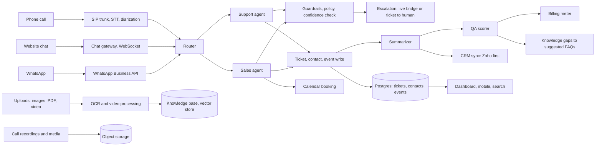

# AIBPO product design
## An AI native support and sales platform

Status: Draft v1
Date: 27 Aug 2026

## 1. What we are building

A SaaS where AI agents run customer support and sales support end to end: phone calls, website chat, and WhatsApp. Every interaction becomes a structured ticket, tied to a contact, summarized, QA scored, and synced to the client's CRM. The buyer self serves the entire onboarding: sign up, pick a number, and their support line is live in the same session. Fourteen day trial, no card required, usage based pricing, no setup fee.

The one line: your support team is live in a minute, you pay for what it handles, and every conversation becomes data you own.

## 2. Design principles

1. Live in a minute. The path from signup to first handled call is under a few minutes. Everything else is refinement, not a prerequisite.
2. Works before it is configured. Default agents with safe boundaries handle day one. Adding knowledge makes them better, but skipping it never blocks launch.
3. Plain language UI. A first time owner should never see jargon. "Call transcript", not "ASR output". "AI assistant", not "LLM agent". "Send it to me", not "reassign to human queue".
4. One object of truth. Every interaction is a ticket. Every ticket belongs to a contact. The contact view is the complete history of a person or company.
5. Show the AI its work. Every action an agent takes is logged with its stated reason. The owner can watch live, replay, and audit any call.
6. A human can take over at any moment. Live bridge or a ticket with full context. The owner is never locked out of their own customers.
7. Pay for usage. No setup fee, no minimum seats, scale up or down anytime.

## 3. Who uses it

- The owner: primary user, usually not technical. Cares about missed calls, new leads, and whether customers are happy.
- Support or sales staff (optional): handle escalations, watch quality, step in on specific conversations.
- The end customer: the person who calls, chats, or messages. They should not be able to tell the difference, except that they get answered.

## 4. Onboarding: from signup to live

Goal: an owner with zero technical knowledge ends this flow with a working support line and has watched it work on their own business.

Step 1. Sign up. Phone number, business name, industry. Thirty seconds. The screen says what is about to happen: "In the next few minutes, this number will answer your customers. Here is how."

Step 2. The tenant is created with defaults. Three agents are on: support, sales, escalation. Default policy: greet politely, find out what the caller needs, give basic info, book a callback or appointment, never promise refunds or discounts. These defaults are safe for any business.

Step 3. Choose how customers reach you. Pick one or more:
- Phone: choose a number from the pool (live immediately) or port your existing number (takes days, the pool number runs meanwhile).
- Website chat: paste one script tag.
- WhatsApp: connect a number through the WhatsApp Business API.

Step 4. Give it context (optional, skippable). Paste your website URL, upload a PDF, or type five lines about the business. The knowledge agent drafts a starter knowledge base from it. If skipped, the agents answer with basics and take a message. Quality improves as knowledge is added, but nothing blocks the launch.

Step 5. The live test. The screen shows: "You are live. Call this number now: XXX." The owner calls their own business number, talks to their AI, and watches the transcript stream in, the ticket appear, and the summary write itself. This moment is the product demo. It doubles as the first real QA data point.

Step 6. Trial starts. Fourteen days, full features, no card. The payment screen appears only on day 13, with a plain usage recap and plan options.

Time budget: signup 30 seconds, channel choice 30 seconds, context 0 to 60 seconds (skippable), test call. A number that answers customers is live in under two minutes.

Consent: recorded calls play a configurable notice at the start ("This call may be recorded for quality purposes"). Wording is set in settings before the first call.

## 5. The agents: who does what, where

| Agent | What it handles | Where you see it |
|---|---|---|
| Router | Every inbound interaction. Detects channel, language, intent (support or sales), and the contact. Routes to the right agent. | "Handled by" on every ticket |
| Support agent | Status checks, FAQs, bookings, complaints, order changes. Creates and resolves support tickets. | Inbox, ticket view |
| Sales agent | Inbound leads. Qualifies (name, need, budget, timing), books appointments, writes the lead to the pipeline. | Leads board, ticket view |
| Escalation agent | Watches every conversation. Decides when a human is needed: sentiment drop, topic outside policy, low confidence, or the customer asks for a person. Builds the handoff with summary, transcript, and suggested resolution. | "Needs you" list on the Today screen |
| Summarizer | Runs on 100% of conversations. Writes the issue, resolution, sentiment, next action, and extracted facts (order ID, amount, date). | Summary tab on every ticket |
| QA agent | Scores every interaction: greeting, accuracy, tone, policy adherence. Flags misses for review. | QA report |
| Knowledge agent | Ingests documents. Watches for questions the agents could not answer. Drafts FAQ entries for one click approval. | Knowledge screen, "Suggested additions" |
| Follow up agent | Sends confirmations on WhatsApp, reminders, and a short NPS after resolution. | Ticket timeline |
| Insight agent | Writes the daily plain language digest: calls handled, new leads, escalations, risks. | Top of the Today screen |

What the owner can set per agent: tone, languages, working hours, what it may promise (refund cap, discount cap), escalation rules, and a do not do list.

Every ticket carries an agent trail: each step, with the time and the reason the agent gave. This is the trust feature. The owner can always answer "why did it say that" and "why did it escalate".

## 6. The data model

The right word for the person or company at the center is **contact**. A lead and a customer are stages of the same contact, not two different objects. One contact, one history, from first call to repeat business.

- Tenant: the company. Everything is scoped to it. Data is isolated per tenant.
- Contact: a person or a company. Identity unified across phone, email, WhatsApp, and CRM ID. Fields: stage (lead, customer, churned), source, profile facts extracted from conversations.
- Conversation: one thread on one channel. A call, a chat session, or a WhatsApp thread. Has direction, start, duration, and media.
- Ticket: the work item created from a conversation (or grouping several). Type: support or sales. Status, priority, assignee (an agent or a human), tags.
- Media: images, videos, PDFs in a conversation. Processed into text: OCR for images and PDFs, transcription for video.
- Transcript: call audio to text, with speaker labels and timestamps. Linked to its conversation.
- Summary: the generated issue, resolution, sentiment, next action, and extracted facts. Attached to the conversation and to the ticket.
- Agent and policy: per tenant configuration for each agent.
- Knowledge base: documents, FAQs, products catalog.
- Event: append only audit log. Every agent and human action, with time and reason.
- CRM link: the contact's CRM ID and the field mapping.
- Usage: the billing meter, per interaction.

Relationships: a tenant has many contacts. A contact has many conversations. A conversation has media and a transcript. A ticket belongs to one contact and one or more conversations. The contact 360 view is all of this for one contact, in timeline order. That view is what syncs to the CRM.

## 7. The screens

Built for a non technical owner. One primary action per screen. No twenty chart dashboards.

### Today (home)
A plain language paragraph from the insight agent at the top: "42 calls today, 0 missed, 9 new leads, 2 need your attention." Then the two items that need a human, each one tap away. Then a small weekly trend. That is the whole screen.

### Inbox
Every conversation across every channel, newest first. Each row: who (name or number), a channel badge (phone, chat, WhatsApp), status (AI handled, waiting for you, resolved), a one line AI summary, and the next action if there is one. Clicking opens the ticket. A human can type a reply at any moment, and the AI steps back on that conversation until it is done.

### Ticket detail
Header: contact name and company, ticket number, type, status, priority, channel badge, start time, duration.

Tabs:
- Conversation: the full call transcript with speaker labels and timestamps, the chat thread, and media (images, PDFs, video) inline.
- Summary: issue, resolution, sentiment, next action, extracted facts.
- Agent trail: what each agent did, when, and why.
- Timeline: every event, including human actions.

Action bar: resolve, send it to me, add a note, schedule a follow up.

### Contacts
Searchable list. Opening a contact shows the 360 view: identity (phone, email, WhatsApp, source, CRM ID), stage, profile facts, the complete timeline of tickets and conversations with summaries, and CRM sync status. This answers "tell me everything about this person" in one screen.

### Leads
A sales pipeline board: new, qualified, contacted, appointment, won, lost. Each lead card shows the qualification data the sales agent captured. Open a card to see the full ticket behind it.

### Agents
One card per agent: what it does, volume handled this week, resolution rate, escalation rate, and a "watch live" button that streams a live call transcript. Settings per agent: tone, languages, hours, boundaries, escalation rules.

### Knowledge
Documents, FAQs, and the products catalog. Upload or paste. A "Suggested additions" list shows questions the agents could not answer, drafted as FAQ entries for one click approval.

### Settings
Numbers and channels, CRM connection and field mapping, team members and roles, recording consent wording, data export, billing and usage.

Universal search: type a name or a phone number anywhere and get the contact, their tickets, and their calls. Empty states teach: "No tickets yet. Call your number to make the first one."

## 8. System architecture

Layer notes:

- Voice path: SIP trunk (Exotel or Twilio for India first) carries the call. Audio is recorded, transcribed with speaker diarization, and the agent responds with text to speech. The transcript streams to the UI live.
- Chat path: the web widget runs over WebSocket. WhatsApp runs through the Business API via a provider. Both feed the same agent runtime, so a contact who calls and then messages lands on the same contact record.
- Attachments: anything sent in any channel (image, video, PDF) goes to object storage, gets processed into text, and enters the agent's context.
- Agent runtime: the router dispatches to specialized agents. Each agent is a policy plus retrieval from the knowledge base plus tools (create ticket, look up order, book appointment, write to CRM, transfer to human). A guardrail layer checks every outbound message against policy: refund caps, forbidden promises, PII handling. Confidence and policy together decide continue or escalate.
- Human handoff: live bridge to a human's app, or async, a ticket with full context. Recommendation: ship async first, live bridge in phase two. Live telephony handoff is the hardest engineering piece here.
- Post processing: an async queue runs the summarizer, entity extraction, sentiment, QA scoring, and knowledge gap detection after every conversation, writes results to the ticket and contact, triggers CRM sync, and meters usage.
- Data: Postgres for tickets, contacts, and events with row level tenant isolation. A vector store for the knowledge base. Object storage for recordings and media, namespaced per tenant. Full export per tenant at any time.
- Integrations: CRM sync (Zoho first, then HubSpot and Salesforce), calendar for bookings, webhooks out on key events.
- Trust stack: the append only event log is the backbone. Every AI action stores its reason. Replay, QA reports, and audit all read from it.
- Security: encryption in transit and at rest, PII handling rules in the guardrail layer, recording consent, tenant isolation, and export.

## 9. Ticket lifecycle

Support ticket: new, AI handling, resolved by AI. Or: new, AI handling, escalated, waiting for human, in progress (human), resolved, closed. Auto close nudges after silence. Reopen allowed.

Sales ticket: new, qualified, contacted, appointment set, won or lost.

Every transition stores who (agent name or human), when, and why, in the event log. The ticket status on screen is always derivable from that log.

## 10. CRM sync

- First integration: Zoho (the default for Indian MSMEs), then HubSpot and Salesforce.
- Connect with OAuth. A field mapping screen maps our fields (phone, stage, last ticket summary, open tickets) to theirs. Plain language, drag and drop, with sensible defaults pre filled.
- Ownership rules: their CRM wins on profile fields. We win on interaction data (tickets, conversations, summaries). This is stated on the mapping screen so there is no surprise.
- Every contact stores the CRM ID. Every ticket stores the CRM reference. Appends never overwrite.
- Webhooks out on ticket created, ticket escalated, lead qualified. Inbound webhooks or polling for stage changes.
- No CRM yet? The contacts and leads screens work standalone. The CRM is an export target, not a requirement. The pitch: your CRM gets richer, not replaced.

## 11. Billing and trial

- The meter counts: call minutes (or per call), resolved chat conversations, and qualified leads as an optional line.
- Trial: fourteen days, full features, no card at signup. Onboarding never touches a payment field.
- Day 13: a plain recap (what was handled, what it would cost) with plan options. No silent auto charge.
- Plans match the public pricing page (Starter, Growth). Overage beyond a plan's included usage bills at a published per unit rate.
- No setup fee. Cancel anytime. This is stated on the pricing page, not buried in terms.

## 12. Trust and transparency (the sales weapon)

- Watch live: a button that streams a real call being handled, transcript appearing in real time.
- Replay: any past call, with recording, transcript, and the agent's decisions side by side.
- QA on 100%: a report of what the AI got right and wrong, per week. BPOs sample 2 to 5%.
- Audit: the reason for every agent action, stored and visible.
- Export: everything, anytime, standard formats.
- Override: a human takes over any conversation at any moment.

These six are also the answer to the buyer's real question: "what happens when the AI gets it wrong?"

## 13. Build order

Phase 1 (MVP):
- Tenant creation and the full onboarding flow (signup to live number)
- Phone (one country, pool numbers), WhatsApp, web chat
- Router, support agent, sales agent, escalation (async, to the owner's app)
- Ticket, contact, conversation, transcript, summary, event log
- Today, Inbox, Ticket detail, Contacts, Leads screens
- Fourteen day trial and usage meter
- Zoho sync, one way (us to them)

Phase 2:
- QA agent and QA reports
- Knowledge suggestions
- Two way CRM sync, calendar booking, video handling
- Live call bridge to humans
- Mobile app for the owner

Phase 3:
- Multi language agents, number porting, analytics, team roles, marketplace of industry templates

## 14. Open questions to settle before building

1. Phone infrastructure and first market: India first with Exotel, or Twilio for multi country from day one?
2. Zoho as the first CRM integration?
3. Recording consent wording per state, and who owns legal sign off on it?
4. Confirm async first for human handoff (recommended) and live bridge in phase two.
5. UI term is "contact" everywhere, with lead and customer as stages. Confirm this language for the whole product.
6. Pricing headline: which meter leads on the pricing page (per resolved conversation, per call minute, or per qualified lead)?
